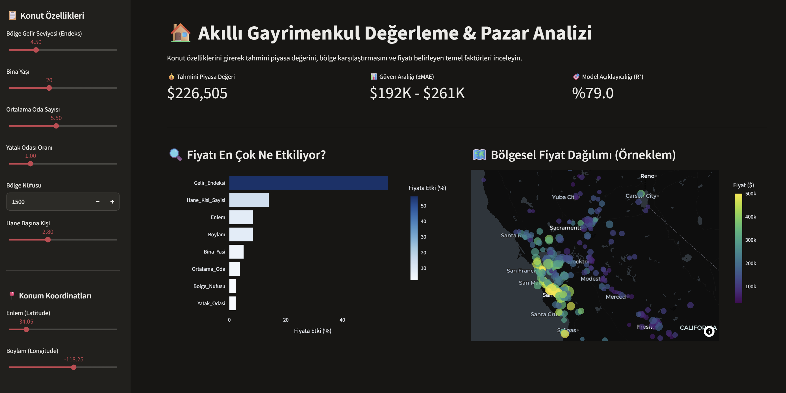

# 🏠 Akıllı Gayrimenkul Değerleme & Pazar Analizi (House Price Prediction)

Tabüler konut verilerini kullanarak tahmini piyasa değerini hesaplayan, güven aralığı sunan ve fiyatı belirleyen faktörleri interaktif grafiklerle görselleştiren uçtan uca bir karar destek panosudur.

## 🖥️ Uygulama Arayüzü

<p align="center">
  
</p>

## ⚙️ Teknik Mimari & Özellikler

* **Model Motoru:** California Housing veri seti üzerinde eğitilmiş **Random Forest Regressor** ($R^2 \approx \%79$).
* **Karar Destek Metrikleri:** Tahmini değerin yanı sıra **±MAE (Ortalama Mutlak Hata)** bazlı dinamik güven aralığı ve özellik önem (Feature Importance) dağılımı.
* **İnteraktif Görselleştirme:** **Plotly** ile dinamik etki analizi grafiği ve coğrafi fiyat dağılım haritası.

## 📁 Proje Yapısı

```text
├── assets/             # Arayüz ekran görüntüleri
├── models/             # Eğitilmiş regresyon modeli (.joblib)
├── src/
│   └── model_engine.py # Veri yükleme, eğitim ve metrik hesaplama motoru
├── app.py              # Streamlit tabanlı etkileşimli web uygulaması
├── .gitignore
├── README.md
└── requirements.txt
```

## 🚀 Yerel Kurulum

```bash
git clone [https://github.com/](https://github.com/)<kullanici-adin>/house-price-prediction.git
cd house-price-prediction
python -m venv .venv
source .venv/Scripts/activate
pip install -r requirements.txt
streamlit run app.py
```